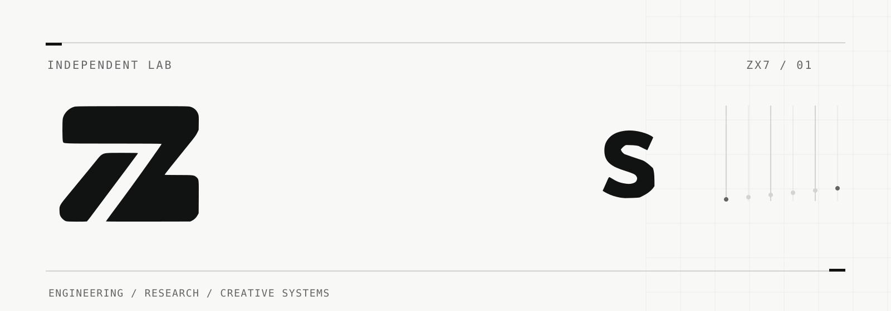

<picture>
  <source media="(prefers-color-scheme: dark)" srcset="assets/zx7-hero-dark.svg">
  <source media="(prefers-color-scheme: light)" srcset="assets/zx7-hero-light.svg">
  
</picture>

### Independent technology lab

**ZX7 Labs** explores the intersection of software engineering, applied intelligence, and creative technology.

We turn ideas into working experiments and useful tools — with attention to design, reliability, and the evidence behind what we build.

---

### What we focus on

| Systems | Intelligence | Creative technology |
| :--- | :--- | :--- |
| Software architecture, developer tools, and dependable infrastructure. | Applied AI, automation, and ways to make complex systems more useful. | Digital creation, interactive tools, and new approaches to creative workflows. |

### How we work

**Understand the problem. Build deliberately. Test what matters.**

Some ideas become software. Others remain experiments or lead us back to better existing solutions. Both outcomes matter.

---

  <a href="https://github.com/ZX7-Labs?tab=repositories"><strong>Explore our public work</strong></a>
  &nbsp;·&nbsp;
  <a href="https://github.com/ZX7-Labs"><strong>GitHub profile</strong></a>

